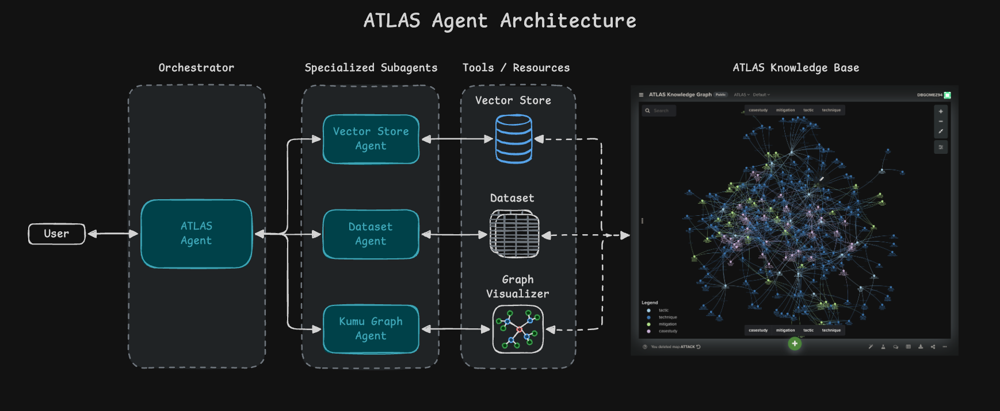

# MITRE ATLAS Agent

`Version 0.0.1 (beta)`

The ATLAS Agent helps answer questions about the [MITRE ATLAS Framework](https://atlas.mitre.org/) by leveraging the [ATLAS Knowledge Graph](https://atlas.mitre.org/knowledge-graph).



## What It Can Do

- Find relevant ATLAS entities (tactics, techniques, mitigations, and case studies) from natural-language descriptions.
- Look up exact ATLAS records by AML ID.
- Summarize relationships among tactics, techniques, mitigations, and case studies.
- Generate focused graph visualizations using the [ATLAS Knowledge Graph](https://atlas.mitre.org/knowledge-graph).

## How It Works

The ATLAS Agent is a hierarchical agentic workflow with an ochestrator which manages three specialist agents:

- **Vector Store Agent**: semantic search over ATLAS entities.
- **Dataset Agent**: structured lookup and relationship extraction from the ATLAS dataset.
- **Kumu Graph Generator Agent**: focused graph URL generation from verified ATLAS IDs.

Typical routing:

1. Natural-language questions use semantic search, then structured verification.
2. Exact AML ID questions use structured lookup, with relationship expansion when useful.
3. Mitigation or case-study questions identify related techniques, then summarize the supporting records.
4. Graph requests verify relevant IDs, then generate a focused Kumu subgraph.

## Getting Started

The ATLAS Agent can be accessed via a simple UI interface or as an MCP Server.

### Chat UI (Recommended)

To gain access to the UI: 

1. Submit a request to [ATLAS Agent Forum](https://teams.microsoft.com/l/channel/19%3A80220a1a42d0430388c05cf2ba15d3be%40thread.tacv2/%F0%9F%A4%96%20ATLAS%20Agent%20Forum?groupId=f5e921f5-b390-4dd7-96f5-e92060886198&tenantId=c620dc48-1d50-4952-8b39-df4d54d74d82) to be added to the list of authorized users.

2. Access the UI at [ATLAS Agent Chat UI](http://atlas-agent.mitre.org:7860/playground/566d098c-b34d-4a80-8ba7-65318106a4db).

### MCP Server

Prerequisites:

- An MCP-compatible client, such as Continue or Cline. See MITRE's guide for [Coding Assistants](https://ai-platform.pages.mitre.org/external-tools/overview/#ai-coding-assistants).
- `uvx` available on your `PATH` so the client can run `mcp-proxy`.

Add the matching configuration to your MCP client.

#### macOS/Linux

```json
{
  "mcpServers": {
    "lf-atlas_agent_mcp": {
      "command": "uvx",
      "args": [
        "mcp-proxy",
        "--transport",
        "streamablehttp",
        "http://atlas-agent.mitre.org:7860/api/v1/mcp/project/6b4977da-f398-4df3-8b00-37e7486b951f/streamable"
      ]
    }
  }
}
```

#### Windows

```json
{
  "mcpServers": {
    "lf-atlas_agent_mcp": {
      "command": "cmd",
      "args": [
        "/c",
        "uvx",
        "mcp-proxy",
        "--transport",
        "streamablehttp",
        "http://atlas-agent.mitre.org:7860/api/v1/mcp/project/6b4977da-f398-4df3-8b00-37e7486b951f/streamable"
      ]
    }
  }
}
```

#### WSL

```json
{
  "mcpServers": {
    "lf-atlas_agent_mcp": {
      "command": "wsl",
      "args": [
        "uvx",
        "mcp-proxy",
        "--transport",
        "streamablehttp",
        "http://atlas-agent.mitre.org:7860/api/v1/mcp/project/6b4977da-f398-4df3-8b00-37e7486b951f/streamable"
      ]
    }
  }
}
```

Restart your MCP client after updating its configuration.

## Example Prompts

- `What ATLAS techniques are most relevant to prompt injection against an LLM application?`
- `Summarize AML.T0051 and list related mitigations.`
- `Which case studies demonstrate attacks against AI supply chains?`
- `Create a graph for AML.T0015 and its related mitigations.`

## Feedback & Community Support

MS Teams: [🤖 ATLAS Agent Forum](https://gitlab.mitre.org/dgomez/atlas-agent-mcp)
